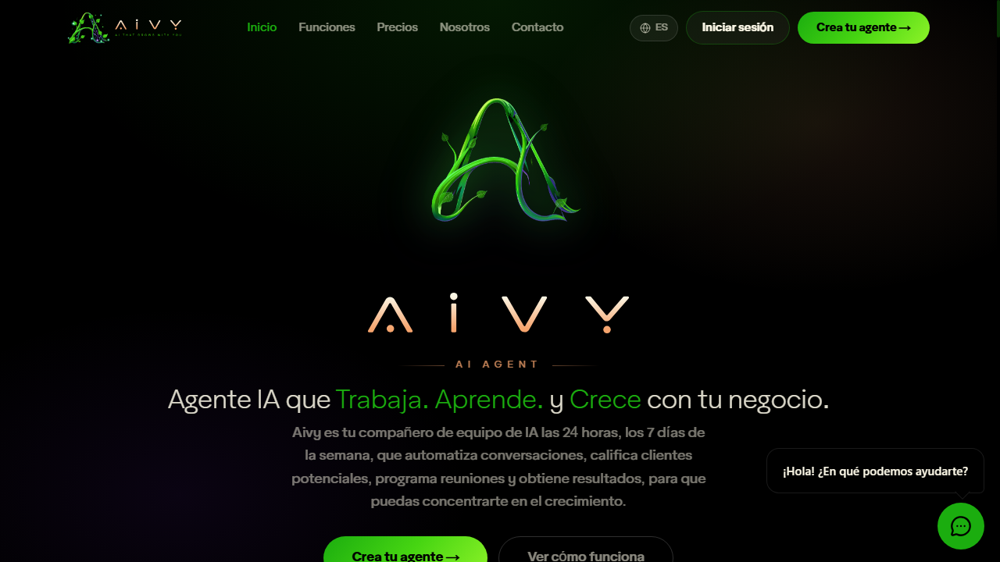

<div align="center">


<a href="https://amethgm.com">

</a>

<p align="center">
<a href="https://amethgm.com/"></a>
<a href="https://sendwaves.cloud/"></a>
<a href="https://aivygrow.ai/"></a>
<a href="https://buymeacoffee.com/amethgmc"></a>
</p>

<p align="center">
<a href="https://linkedin.com/in/ameth-galarcio-87bba011a"></a>
<a href="https://dribbble.com/ameth1208"></a>
<a href="https://x.com/Ameth1208"></a>
<a href="https://youtube.com/@ameth1208"></a>
<a href="https://tiktok.com/@ameth1208"></a>
<a href="https://github.com/ameth1208"></a>

</p>

</div>

---

### 🚀 About Me & Rapid Fire

> **Passionate full-stack & mobile engineer, creating robust and scalable applications with clean code and high performance.** Skilled in both front-end and back-end architectures, with a keen eye for user experience, fluid animations, and real-time distributed systems.

- 💼 **I'm currently working on:** Scaling **[SendWaves CRM & Cloud](https://sendwaves.cloud/)**, expanding **[AiVYGrow.ai](https://aivygrow.ai/)**, and maintaining **[Atlas Bucket Manager](https://github.com/Ameth1208/atlas-bucket-manager)**.
- 💬 **Ask me about:** **SendWaves CRM & messaging architecture**, building **high-performance Go microservices**, **real-time multiplayer engines in Flutter & WebSockets**, or **custom automation bots**.
- 📂 **Portfolio:** [**https://amethgm.com/**](https://amethgm.com/)
- 📍 **Location:** Colombia 🇨🇴 *(Available for global remote contracts, SaaS partnerships & high-impact projects)*
- ⚡ **Fun Fact:** Started software development in **2016** and haven't stopped building production-ready products since!

---

### 🏛️ Engineering Pillars

<table align="center" width="100%">
<tr>
<td width="25%" align="center">
<h4>💻 Desarrollo</h4>
<p>Web & Mobile Apps robustas, reactivas y escalables (Next.js, React, Flutter, React Native, Go).</p>
</td>
<td width="25%" align="center">
<h4>🧼 Clean Code</h4>
<p>Arquitectura desacoplada, tipado estricto, microservicios y código altamente mantenible.</p>
</td>
<td width="25%" align="center">
<h4>⚡ Automatización</h4>
<p>Bots de WhatsApp & Telegram, webhooks, n8n y pipelines para optimizar procesos de negocio.</p>
</td>
<td width="25%" align="center">
<h4>🎨 UI / UX</h4>
<p>Diseño en Figma, micro-interacciones fluidas, animaciones modernas y experiencia intuitiva.</p>
</td>
</tr>
</table>

---

### 🌟 Featured Flagship Projects

<table width="100%">
<tr>
<td width="50%" valign="top">
<a href="https://github.com/Ameth1208/atlas-bucket-manager">

</a>
<h3>🪣 <a href="https://github.com/Ameth1208/atlas-bucket-manager">Atlas Bucket Manager</a></h3>
<p>


</p>
<p><strong>High-Performance Multi-Cloud UI & API for S3 Storage (MinIO alternative)</strong></p>
<ul>
<li>Unified dashboard for MinIO, AWS S3, Cloudflare R2, Spaces, and Wasabi.</li>
<li>Instant cold boot (&lt;30ms) with ~20MB RAM in Go + CGO-free SQLite.</li>
<li>On-the-fly streaming of multi-item ZIP downloads directly from S3 without disk buffering.</li>
<li>Global multi-provider file search and private preview proxy tunnel.</li>
</ul>
<p><a href="https://github.com/Ameth1208/atlas-bucket-manager"><strong>View Repository & Code →</strong></a></p>
</td>

<td width="50%" valign="top">
<a href="https://sendwaves.cloud/">

</a>
<h3>🌊 <a href="https://sendwaves.cloud/">SendWaves CRM & Cloud API</a></h3>
<p>


</p>
<p><strong>Enterprise Multi-Channel CRM & Messaging Automation Platform</strong></p>
<ul>
<li>Unified CRM inbox for WhatsApp Business, Telegram, Instagram & Messenger.</li>
<li>Multi-instance orchestration, chat history, and automated team contact routing.</li>
<li>Native ecosystem integrations with Chatwoot, n8n, Typebot, OpenAI, and Webhooks.</li>
<li>Engineered for high-volume customer relationship management and automated pipelines.</li>
</ul>
<p><a href="https://sendwaves.cloud/"><strong>Visit SendWaves Platform →</strong></a></p>
</td>
</tr>

<tr>
<td width="50%" valign="top">
<a href="https://aivygrow.ai/">

</a>
<h3>🤖 <a href="https://aivygrow.ai/">AiVY Grow (aivygrow.ai)</a></h3>
<p>


</p>
<p><strong>24/7 Autonomous AI Teammates for Modern Businesses</strong></p>
<ul>
<li>Natural-sounding voice agents handling phone calls with zero hold times.</li>
<li>Live chat lead qualification across web, WhatsApp, and social media.</li>
<li>Automated calendar booking, scheduling, and reminder synchronization.</li>
<li>Smart routing of qualified hot prospects directly into your team's CRM.</li>
</ul>
<p><a href="https://aivygrow.ai/"><strong>Discover AiVY Platform →</strong></a></p>
</td>

<td width="50%" valign="top">
<a href="https://amethgm.com/projects">

</a>
<h3>🕵️‍♂️ <a href="https://amethgm.com/projects">Fakeit: Impostor Game</a></h3>
<p>


</p>
<p><strong>Real-Time Multiplayer Game Engine & Cross-Platform Mobile App</strong></p>
<ul>
<li>Fast-paced multiplayer social deduction game engine.</li>
<li>Low-latency room synchronization and distributed game state via WebSockets.</li>
<li>Cross-platform client built with Flutter featuring fluid UI animations.</li>
<li>Scalable backend with Node.js, Prisma ORM, and PostgreSQL.</li>
</ul>
<p><a href="https://amethgm.com/projects"><strong>Explore Case Study & Demo →</strong></a></p>
</td>
</tr>
</table>

---

### 🧩 More Architectural Works

<table width="100%">
<tr>
<td width="50%" valign="top">
<h4>📑 Folio — Colombian Electronic Invoicing SaaS (DIAN)</h4>
<p>Production developer architecture featuring Go HTTP API + Go Worker, PostgreSQL with Row-Level Security (RLS), encrypted PFX/P12 certificate management, Factus v2 adapter, and native <strong>Model Context Protocol (MCP)</strong> server integration.</p>
<p><code>Go 1.24+</code> · <code>Next.js 16</code> · <code>PostgreSQL RLS</code> · <code>MinIO / S3</code> · <code>MCP</code></p>
</td>
<td width="50%" valign="top">
<h4>⚡ <a href="https://github.com/Ameth1208/zeus">Zeus — Multi-Agent Control Plane</a></h4>
<p>Provider-neutral desktop and mobile orchestrator for autonomous AI coding runtimes (Codex, Claude Code, Antigravity). Built with a high-throughput Go Gateway, Rust/Tauri 2 desktop, SwiftUI macOS notch bar, and Flutter mobile controller.</p>
<p><code>Go Gateway</code> · <code>Rust</code> · <code>Tauri 2</code> · <code>Flutter</code> · <code>SwiftUI</code></p>
</td>
</tr>
</table>

---

### 🛠️ Comprehensive Tech Stack & Architectural Arsenal

<p><em>Extracted and battle-tested across production SaaS platforms, high-concurrency microservices, multi-cloud storage tools, and real-time mobile apps.</em></p>

<table width="100%">
<tr>
<td width="50%" valign="top">
<h4>⚡ 1. Core Languages & Runtimes</h4>
<p>
<a href="https://skillicons.dev"></a>
</p>
<ul>
<li><strong>Go (Golang 1.26):</strong> Concurrency with Goroutines, Worker Pools, Gin, native MinIO-Go SDK, CGO-free modernc.org/sqlite, streaming pipelines.</li>
<li><strong>Rust:</strong> High-performance desktop integration with Tauri 2, memory-safe system utilities.</li>
<li><strong>TypeScript & JavaScript:</strong> Modern ESNext, Node.js, Bun, Fastify, Express, strict type contracts.</li>
<li><strong>Dart:</strong> Enterprise Flutter applications, reactive streams, Riverpod state management.</li>
<li><strong>Python:</strong> FastAPI, Flask, web scraping engines, AI audio processing pipelines (PyTorch/Spleeter).</li>
</ul>
</td>

<td width="50%" valign="top">
<h4>🎨 2. Frontend & Cross-Platform Mobile</h4>
<p>
<a href="https://skillicons.dev"></a>
</p>
<ul>
<li><strong>Next.js 16 & React 19:</strong> App Router, Server Components, Server Actions, Turbopack, SEO-driven architecture.</li>
<li><strong>Flutter (iOS & Android):</strong> Low-latency 60fps animations, custom canvas painters, Rive integration, offline-first caching.</li>
<li><strong>Tailwind CSS v4 & shadcn/ui:</strong> Radix UI headless primitives, design tokens, accessible design systems.</li>
<li><strong>Framer Motion:</strong> Interactive micro-interactions, layout morphing, animated theme toggles.</li>
<li><strong>Desktop & Native:</strong> Tauri 2 (Rust + Webview), native macOS SwiftUI / AppKit.</li>
</ul>
</td>
</tr>

<tr>
<td width="50%" valign="top">
<h4>⚙️ 3. Backend, Systems & Real-Time Streams</h4>
<p>
<a href="https://skillicons.dev"></a>
</p>
<ul>
<li><strong>Architectural Patterns:</strong> Clean Architecture, Domain-Driven Design (DDD), Hexagonal Architecture, Monorepos (pnpm workspaces).</li>
<li><strong>Real-Time Concurrency:</strong> WebSockets, Socket.io, Server-Sent Events (SSE), distributed room synchronization (as built in <em>Fakeit</em>).</li>
<li><strong>Zero-Disk Streaming:</strong> Direct S3-to-client multi-gigabyte ZIP streaming via Go <code>archive/zip</code> without disk I/O bottlenecks.</li>
<li><strong>API Design & Contracts:</strong> RESTful APIs, OpenAPI 3.0 / Swagger, gRPC, Model Context Protocol (MCP).</li>
</ul>
</td>

<td width="50%" valign="top">
<h4>🪣 4. Multi-Cloud Storage & Database Engines</h4>
<p>
<a href="https://skillicons.dev"></a>
</p>
<ul>
<li><strong>Multi-Cloud Object Storage (S3):</strong> MinIO, AWS S3, Cloudflare R2, DigitalOcean Spaces, Wasabi Hot Cloud Storage.</li>
<li><strong>PostgreSQL:</strong> Complex schema modeling, multi-tenant isolation via <strong>Row Level Security (RLS)</strong> (as engineered in <em>Folio</em>).</li>
<li><strong>Prisma ORM:</strong> Type-safe database queries, automated migrations, high-throughput indexing.</li>
<li><strong>Redis:</strong> In-memory distributed caching, Pub/Sub messaging, token bucket rate limiting.</li>
<li><strong>SQLite:</strong> High-speed embedded local databases without CGO dependencies.</li>
</ul>
</td>
</tr>

<tr>
<td width="50%" valign="top">
<h4>🤖 5. AI Systems, Messaging & Automation</h4>
<p>


</p>
<ul>
<li><strong>Model Context Protocol (MCP):</strong> Authoring native MCP servers allowing LLMs & AI agents to interface directly with cloud APIs.</li>
<li><strong>Autonomous AI Agents:</strong> Voice AI calling agents, 24/7 conversational lead qualification, calendar synchronization (engineered for <em>AiVY</em>).</li>
<li><strong>WhatsApp & Omnichannel Gateways:</strong> WhatsApp Business API, Baileys, Evolution API, Telegram Bot API, Instagram, Messenger (as built in <em>SendWaves CRM</em>).</li>
<li><strong>Message Queues & Event Streaming:</strong> RabbitMQ, AWS SQS, Apache Kafka, durable webhooks with automatic retries.</li>
</ul>
</td>

<td width="50%" valign="top">
<h4>🛠️ 6. DevOps, Security & Engineering Tools</h4>
<p>
<a href="https://skillicons.dev"></a>
</p>
<ul>
<li><strong>Containerization:</strong> Multi-stage Docker builds, Docker Compose orchestration for all-in-one local environments.</li>
<li><strong>Linux & Ingress:</strong> Cloud VPS administration, Caddy automatic TLS, Nginx reverse proxying, secure tunnel proxies.</li>
<li><strong>Cryptographic Security:</strong> AES-256-GCM keystores, PFX/P12 fiscal certificate handling, SHA-256 scoped bearer tokens, HttpOnly cookies.</li>
<li><strong>Product Design & CI/CD:</strong> High-fidelity wireframing and prototyping in Figma, GitHub Actions automated test & release pipelines.</li>
</ul>
</td>
</tr>
</table>

---

### 📂 Interactive Developer CV

<details>
<summary><strong>💼 1. Comprehensive Professional Journey (2016 – Present) [Click to expand]</strong></summary>

```text
[2016] ──> Full-Stack Web & UI/UX Design foundations
[2018] ──> Mobile Apps (Flutter / React Native) & Reactive Architectures
[2021] ──> Distributed Microservices, High-Volume Bots (Baileys/WhatsApp APIs)
[2023] ──> Scalable Multi-Tenant Platforms (SendWaves, Electronic Invoicing SaaS)
[2025+] ─> Autonomous AI Agents (AiVY, MCP), Multi-Cloud Systems (Atlas Bucket Manager, Go)
```

- **Distributed Cloud Architectures:** Designed microservices in Go and TypeScript with event-driven pipelines, WebSockets, and horizontal scaling.
- **SaaS Founder & Lead Engineer:** Shipped [SendWaves.cloud](https://sendwaves.cloud/) and [aivygrow.ai](https://aivygrow.ai/) from ground zero to production.
- **Mobile Engineering Excellence:** Authored cross-platform mobile products in Flutter with 60fps animations, local caching, and offline-first support.
</details>

<details>
<summary><strong>🏛️ 2. Architectural Principles & Performance Metrics [Click to expand]</strong></summary>

- **Zero-Disk Streaming:** Implemented concurrent Go goroutine pipelines for direct S3-to-client streaming, avoiding disk bloat on multi-gigabyte transfers.
- **Data Isolation & Multi-Tenancy:** PostgreSQL Row Level Security (RLS) enforcement preventing cross-tenant leakage in mission-critical billing systems.
- **Cryptographic Security:** AES-256-GCM encrypted keystores for sensitive credentials (PFX/P12 fiscal certificates, scoped bearer tokens).
- **Clean Code & Domain Boundaries:** Decoupled business logic from transport layers (HTTP/gRPC/WebSocket), ensuring 100% testable services.
</details>

<details>
<summary><strong>🤝 3. Product Leadership, Agile & UI/UX Craftsmanship [Click to expand]</strong></summary>

- **Agile Execution:** Sprint tracking, iterative prototyping, automated CI/CD checks, and semantic release workflows.
- **Human-Centered UI/UX:** Complete design workflows from wireframes and design systems in Figma to pixel-perfect React/Next.js/Flutter components.
- **AI Agent Protocols:** Early adopter of Model Context Protocol (MCP) to make proprietary APIs natively accessible to AI coding runtimes.
</details>

---

### 📊 GitHub Activity & Real-Time Stats

<div align="center">
<p align="center">


</p>
<p align="center">

</p>
</div>

---

### ☕ Support My Open-Source Journey

If my open-source tools or libraries like **Atlas Bucket Manager** or **Zeus** helped you, consider supporting further development:

<p align="center">
<a href="https://buymeacoffee.com/amethgmc" target="_blank">

</a>
&nbsp;&nbsp;&nbsp;&nbsp;
<a href="https://paypal.me/Game8CO" target="_blank">

</a>
</p>

---

<div align="center">
<h3>🤝 Let's Build Something Extraordinary</h3>
<p>Whether you're looking for high-scale architectural design, SaaS co-building, or innovative mobile/AI apps:</p>
<p>
<a href="https://amethgm.com/"><strong>🌐 amethgm.com</strong></a> &nbsp;•&nbsp; 
<a href="https://sendwaves.cloud/"><strong>🌊 sendwaves.cloud</strong></a> &nbsp;•&nbsp; 
<a href="https://aivygrow.ai/"><strong>🤖 aivygrow.ai</strong></a> &nbsp;•&nbsp; 
<a href="https://linkedin.com/in/ameth-galarcio-87bba011a"><strong>💼 LinkedIn</strong></a> &nbsp;•&nbsp; 
<a href="mailto:amethgalarcio1208@gmail.com"><strong>📫 Email Me</strong></a>
</p>
<sub>© 2026 Ameth Galarcio · Engineered with precision and passion.</sub>
</div>
